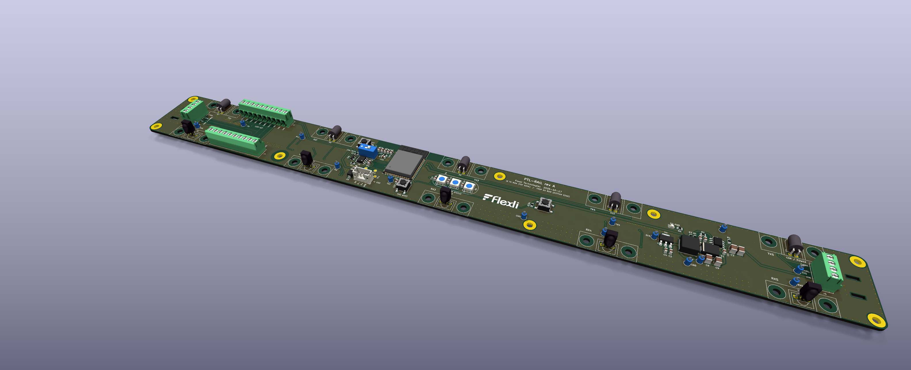
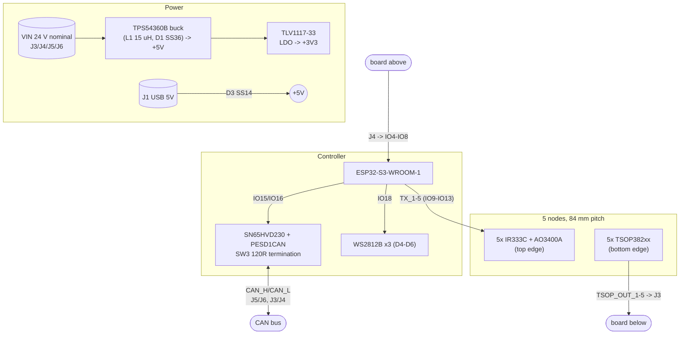
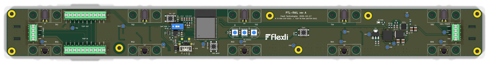
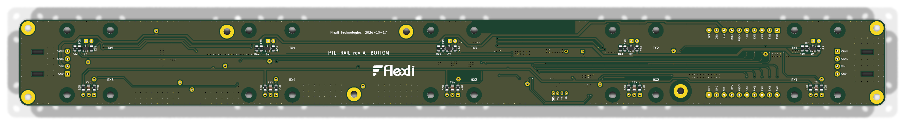
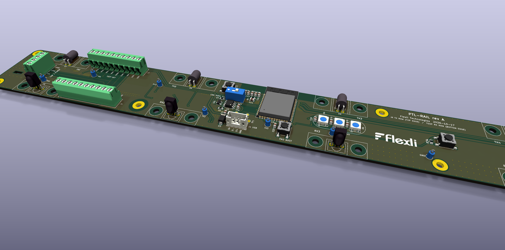
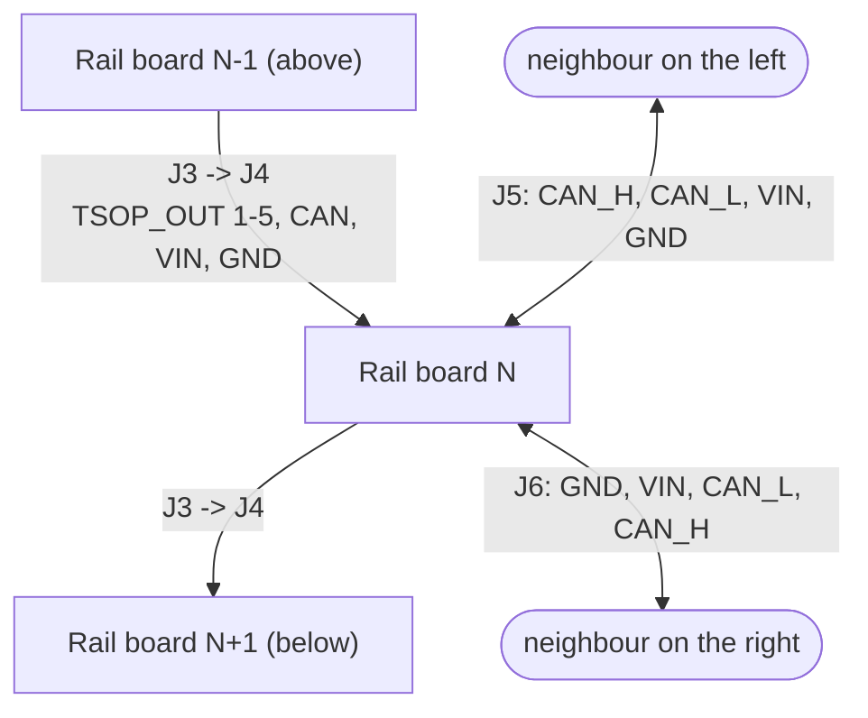
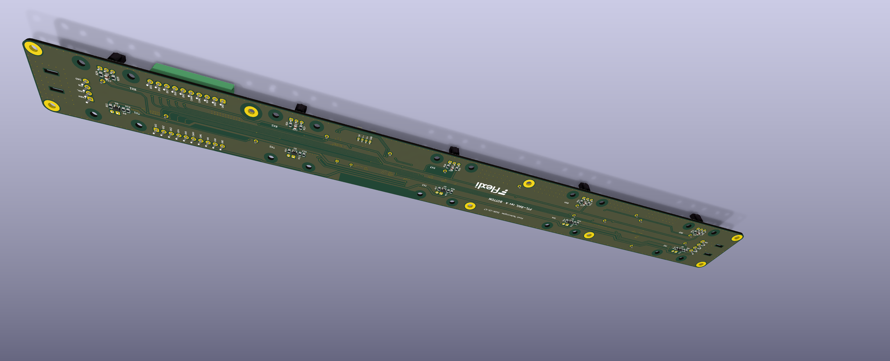

# PTL-RAIL — Meesho Put-To-Light IR Rail

Modular, daisy-chained **5-node IR emitter/receiver rail** for the Meesho
put-to-light system. Each 400 mm board has five bin positions on an 84 mm pitch.
Each position has an IR LED firing out of the top edge into the bin above and a
TSOP IR receiver looking out of the bottom edge into the bin below. An onboard
**ESP32-S3** drives the emitters, reads its own receivers and the receivers of
the board above, and talks to the rest of the system over **CAN**. Power, CAN
and the receiver signals pass from board to board through screw terminals.



| | |
|---|---|
| **Board** | PTL-RAIL |
| **Revision** | rev A (v1.0) |
| **Status** | Released as [`ptl-rail-rev-a-v1.0`](../../releases/tag/ptl-rail-rev-a-v1.0). ERC/DRC clean; see [§14](#14-known-issues-rev-a) for open items |
| **EDA** | KiCad 10 |
| **License** | Private / Internal (Flexli Technologies) |

---

## 1. Overview

One board type, chained end to end along a rack:

- **IR emitter row (top edge):** 5× IR333C 5 mm IR LEDs (D7–D11), mounted horizontally so the lens points out of the top edge. Each LED is switched by an AO3400A low-side MOSFET (Q1–Q5) from an ESP32 GPIO (`TX_1`…`TX_5`).
- **IR receiver row (bottom edge):** 5× TSOP382xx (U6–U10), lens pointing out of the bottom edge. Their outputs (`TSOP_OUT_1`…`5`) leave on **J3** to the board below. The receivers of the board above arrive on **J4** (`TSOP_OUT_n_ESP`) and go into the ESP32.
- **3D-printed shrouds:** each LED and each TSOP sits under a printed shroud (28 mm silk outline), held by two M3 screws, which reduces reflections and narrows the field of view.
- **Controller:** ESP32-S3-WROOM-1 (native USB through J1, onboard antenna overhanging the top edge), WS2812B status LEDs, RST/BOOT buttons and a user ACK button.
- **Bus and power:** CAN via SN65HVD230 with PESD1CAN ESD and switchable 120 Ω termination. VIN (24 V nominal) → TPS54360B buck → +5 V → TLV1117-33 → +3V3.

---

## 2. Architecture Block Diagram



---

## 3. Board Snapshots

### Top



### Bottom (node passives and MOSFETs)



### Node 2, ESP32, USB and CAN close-up



---

## 4. Features

| | |
|---|---|
| Board | 400 × 40 mm, 2-layer FR-4, 1.6 mm. 4 mm corner radius, concentric with the corner holes |
| Nodes | 5. Centres at x = 32, 116, 200, 284, 368 mm from the left edge |
| Emitters | IR333C, 180 Ω from +5 V, AO3400A low-side switch, 100 Ω gate resistor and 100 kΩ pull-down |
| Receivers | TSOP382xx on +3V3 through 100 Ω + 4.7 µF, 100 Ω series resistor on the output |
| Controller | ESP32-S3-WROOM-1, native USB (USBLC6-2 ESD) on J1 |
| Bus | CAN, SN65HVD230, PESD1CAN, switchable 120 Ω termination (SW3 + R7) |
| User I/O | SW1 RST, SW2 BOOT, SW4 ACK_BUTTON (IO14, 10 kΩ pull-up, 100 nF), D2 power LED, D4–D6 WS2812B |
| Copper | GND pour on both layers, redundant GND vias, GND via fence along the board edge |
| Test | TP1–TP19 (loop test points on every TX/RX signal and every rail, see [§10](#10-test-points)) |

---

## 5. Absolute Maximum Ratings

Stress ratings come from the component datasheets. **Rev A has no input protection** (see [§14](#14-known-issues-rev-a)), so these are the limits of the silicon itself.

| Parameter | Limiting part | Min | Max | Unit |
|---|---|---:|---:|---|
| `VIN` | TPS54360B (U2) | −0.3 | 65 | V |
| `VIN` on C1/C3 | capacitor rating, not yet specified | — | rating TBD | V |
| CAN_H / CAN_L bus pins | SN65HVD230 (U5) | −4 | 16 | V |
| +3V3 rail | ESP32-S3 / TLV1117 output | −0.3 | 3.6 | V |
| +5V rail | USBLC6-2 VBUS (U4) | −0.3 | 5.5 | V |

## 6. Recommended Operating Conditions

| Parameter | Min | Typ | Max | Unit |
|---|---:|---:|---:|---|
| `VIN` | 4.5 (U2) | 24 | 60 (U2), subject to C1/C3 rating | V |
| CAN data rate | — | — | 1 | Mbps |

---

## 7. System Wiring Diagram



J3 carries this board's receiver outputs down to the next board's J4, which
feeds that board's ESP32 IO4–IO8. J3/J4 also pass CAN and power. J5/J6 at the
two ends of the board are mirrored 4-way CAN + power terminals for chaining
along the rail. The J3 → J4 pin order is reversed (J3.1 = RX1, J4.10 = RX1), so
**check the harness before first power-up**.

---

## 8. Connector Reference

Pin labels are printed on both silkscreen sides.

| Connector | Type | Pinout (1→N) |
|---|---|---|
| `J3` TSOP OUT | 10-way 3.5 mm screw terminal | 1–5: `RX1`…`RX5` (TSOP_OUT_1…5) · 6: `CAN_H` · 7: `CAN_L` · 8: `VIN` · 9: `GND` · 10: `GND` |
| `J4` TSOP IN | 10-way 3.5 mm screw terminal | 1: `GND` · 2: `GND` · 3: `VIN` · 4: `CAN_L` · 5: `CAN_H` · 6–10: `RX5`…`RX1` (TSOP_OUT_5…1_ESP) |
| `J5` (left end) | 4-way 3.5 mm screw terminal | 1: `CAN_H` · 2: `CAN_L` · 3: `VIN` · 4: `GND` |
| `J6` (right end) | 4-way 3.5 mm screw terminal | 1: `GND` · 2: `VIN` · 3: `CAN_L` · 4: `CAN_H` |
| `J1` USB | JST-PH 4-way | 1: `GND` · 2: `D+` · 3: `D−` · 4: `5V` (VBUS, via D3) |
| `SW3` | slide DIP | ON = 120 Ω (R7) across CAN_H/CAN_L |

---

## 9. ESP32-S3-WROOM-1 Pin Allocation

| Pin # | Pin name | Net / function |
|---:|---|---|
| 1 | `GND` | Ground |
| 2 | `3V3` | 3.3 V supply |
| 3 | `EN` | `ESP_EN`, reset (SW1) |
| 4 | `IO4` | `TSOP_OUT_1_ESP` (J4.10) |
| 5 | `IO5` | `TSOP_OUT_2_ESP` (J4.9) |
| 6 | `IO6` | `TSOP_OUT_3_ESP` (J4.8) |
| 7 | `IO7` | `TSOP_OUT_4_ESP` (J4.7) |
| 8 | `IO15` | `CAN_TX` |
| 9 | `IO16` | `CAN_RX` |
| 10 | `IO17` | *unused* |
| 11 | `IO18` | `STATUS_LED` (WS2812B DIN, D4→D5→D6) |
| 12 | `IO8` | `TSOP_OUT_5_ESP` (J4.6) |
| 13 | `IO19` | `USB_D-` |
| 14 | `IO20` | `USB_D+` |
| 15 | `IO3` | *unused (strap pin)* |
| 16 | `IO46` | *unused (strap pin)* |
| 17 | `IO9` | `TX_1` (emitter node 1) |
| 18 | `IO10` | `TX_2` |
| 19 | `IO11` | `TX_3` |
| 20 | `IO12` | `TX_4` |
| 21 | `IO13` | `TX_5` |
| 22 | `IO14` | `ACK_BUTTON` (SW4) |
| 23–25 | `IO21`, `IO47`, `IO48` | *unused* |
| 26 | `IO45` | *unused, no-connect (VDD_SPI strap; keep low at boot)* |
| 27 | `IO0` | `GPIO0`, BOOT (SW2) |
| 28–35 | `IO35`–`IO42` | *unused* |
| 36, 37 | `RXD0`, `TXD0` | *unused (UART0 debug)* |
| 38, 39 | `IO2`, `IO1` | *unused (ADC-capable)* |
| 40, 41 | `GND` | Ground / thermal pad |

---

## 10. Test Points

| TP | Net | Footprint |
|---|---|---|
| TP1 / TP2 | `USBC_D+` / `USBC_D−` (connector side) | SMD pad Ø1.5 mm |
| TP3 / TP4 | `USB_D+` / `USB_D−` (ESP32 side) | SMD pad Ø1.5 mm |
| TP5 … TP9 | `TX_1` … `TX_5` | Loop Ø1.8 mm, drill 1.0 mm |
| TP10 … TP14 | `TSOP_OUT_1` … `TSOP_OUT_5` | Loop Ø1.8 mm, drill 1.0 mm |
| TP15 / TP16 / TP17 | `VIN` / `+5V` / `+3V3` | Loop Ø1.8 mm, drill 1.0 mm |
| TP18 / TP19 | `GND` | Loop Ø1.8 mm, drill 1.0 mm |

---

## 11. Mounting & IR Shrouds

- **Rail fixing:** H1–H4 (corners, M3 with plated pad, 4 mm from each edge) and H25–H28 (mid-board, M3 with plated pad).
- **Shroud fixing:** H5–H24 are NPTH Ø3.2 mm, at each node centre ±10 mm, 5.0 mm (LED side) and 35.0 mm (TSOP side) from the top edge. The 28 mm silk outlines show each shroud's footprint; no parts are placed inside them.
- **Antenna:** the ESP32 antenna overhangs the top edge by about 15 mm. Keep the rack upright and any metal clear of it.

---

## 12. Fabrication & Assembly

**Fabrication**
- 2-layer FR-4, 1.6 mm. Copper weight and surface finish are not specified in the design; 1 oz and HASL-LF or ENIG are suitable.
- Design rules: min track 0.2 mm, clearance 0.2 mm, via 0.6/0.3 mm, min hole 0.3 mm, copper-to-edge 0.5 mm, hole-to-hole 0.25 mm.
- U3's thermal-pad vias use 0.2 mm holes, below the 0.3 mm design rule. Confirm your fab can make them.
- **Panel:** 2-up, 400 × 127 mm. Board 2 is rotated 180° so both antenna overhangs land on the 20 mm top/bottom rails. Each long edge has 7 mouse-bite tabs (Ø0.5 mm, 0.8 mm pitch, 3 mm wide), placed clear of the LEDs, TSOPs, connectors and antenna. The rails carry 3 fiducials and 3 tooling holes.

**Assembly**
- **Top:** ESP32, power stage, CAN, WS2812Bs, switches, connectors, IR LEDs, TSOPs.
- **Bottom:** all node passives and MOSFETs (R9–R33, C22–C26, Q1–Q5).
- **Through-hole:** IR LEDs, TSOPs, screw terminals, J1, SW3 and the loop test points.



---

## 13. Releases

The production files are attached to each [GitHub release](../../releases). The current release is [`ptl-rail-rev-a-v1.0`](../../releases/tag/ptl-rail-rev-a-v1.0):

| Asset | File |
|---|---|
| Bill of Materials | `PTL-RAIL_revA_BOM.csv` (grouped by Value + Footprint; test points and holes excluded) |
| Gerbers + drill files (fabrication, 2-board panel) | `PTL-RAIL_revA_gerbers_drill_panel-2up.zip` (with panel pick-and-place in `assembly/`) |
| Interactive BOM | `PTL-RAIL_revA_ibom.html` |
| IPC netlist | `PTL-RAIL_revA_netlist.ipc` (IPC-D-356) |
| Pick-and-place position file | `PTL-RAIL_revA_pick-and-place.csv` (single board, both sides, mm) |
| Reference designator list | `PTL-RAIL_revA_refdes.csv` |
| Schematic (PDF plot) | `PTL-RAIL_revA_schematic.pdf` |
| Schematic (KiCad source) | `PTL-RAIL_revA_kicad-source.zip` (project, sheets, PCB, libraries, 3D models, panel PCB) |

### Repository layout

```
.
├── README.md                      This file
└── PTL-RAIL/
    ├── PTL-RAIL.kicad_pro         KiCad project
    ├── PTL-RAIL.kicad_sch         Root sheet
    ├── PTL-RAIL.kicad_pcb         Board layout
    ├── esp32.kicad_sch            ESP32-S3, USB, buttons, status LEDs, test points
    ├── power.kicad_sch            TPS54360B buck, TLV1117 LDO
    ├── can.kicad_sch              SN65HVD230 CAN interface
    ├── connectors.kicad_sch       J3/J4/J5/J6
    ├── tx_nodes.kicad_sch         5x IR emitter + MOSFET
    ├── rx_nodes.kicad_sch         5x TSOP receiver
    ├── lib/                       Project symbols, footprints (0_IC) and 3D models
    └── Docs/
        ├── datasheets/            Component datasheets
        └── renders/               Board renders used in this README
```

---

## 14. Known Issues (rev A)

1. **No 24 V input protection.** VIN goes straight to C1/C3 and U2: no fuse, reverse-polarity protection, TVS or bulk capacitor.
2. **CAN_L sits next to VIN** on J3 (7/8), J4 (3/4), J5 (2/3) and J6 (2/3). The SN65HVD230 bus pins are rated −4 … +16 V, so a 24 V short destroys the transceiver. Either separate the pins with GND or use a ±58/70 V part (e.g. TCAN1042, MCP2562FD).
3. **J3/J4 pin order is reversed.** Check the board-to-board harness.
4. **J4 inputs are unprotected.** IO4–IO8 connect straight to an off-board connector with no series resistor, pull-up, RC filter or ESD protection.
5. **WS2812B data level.** It is driven at 3.3 V while the LEDs run on 5 V (V_IH = 0.7 × VDD), which is marginal.
6. **No capacitor voltage ratings or MPNs.** C1/C3 sit on 24 V and need ≥ 50 V.
7. **U3 overlaps the node-3 emitter shroud and hole H19** (DRC exclusion set).
8. **J3–J6 3D models** are a Phoenix PT 3.5 mm stand-in (KiCad has no 4Ucon models). This affects renders only.

---

## 15. Revision History

| Revision | Date | Notes |
|---|---|---|
| rev A scaffold | 2026-10-17 | KiCad project skeleton: outline, holes, node markers, sheets. |
| rev A placement | 2026-10-17 | LED row on the top edge, TSOP row on the bottom edge, node parts at 84 mm pitch, J3/J4 10-way and J5/J6 4-way terminals, CAN block, buttons, status LEDs, mounting holes. |
| rev A layout | 2026-10-18 | IR shroud outlines and holes, node parts moved to the bottom side, routing with filleted bus, GND vias and edge via fence, silkscreen cleanup, mid-board holes, rounded corners, test points TP5–TP19, SW4 ACK button on IO14. |
| **rev A v1.0** | 2026-10-18 | Values normalised, ERC/DRC clean, 3D models, production files and release [`ptl-rail-rev-a-v1.0`](../../releases/tag/ptl-rail-rev-a-v1.0). |

---

© Flexli Technologies. Private / internal.
